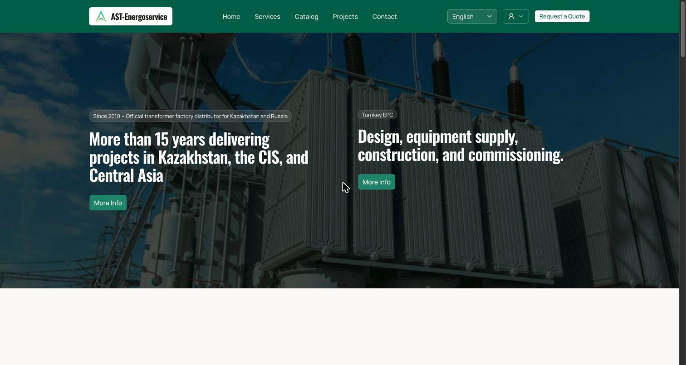
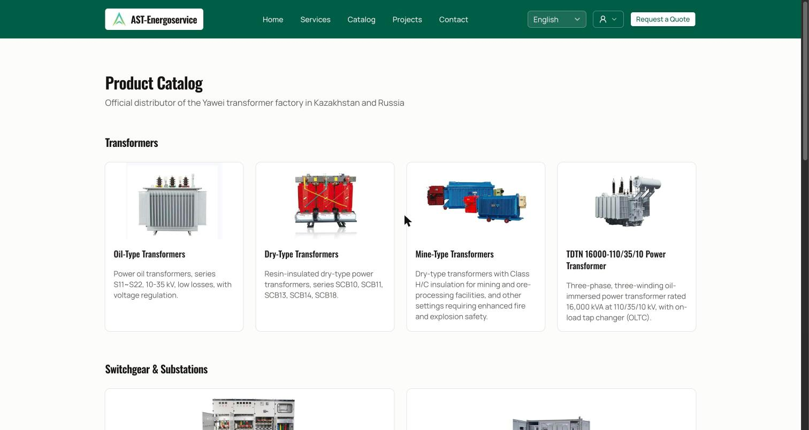
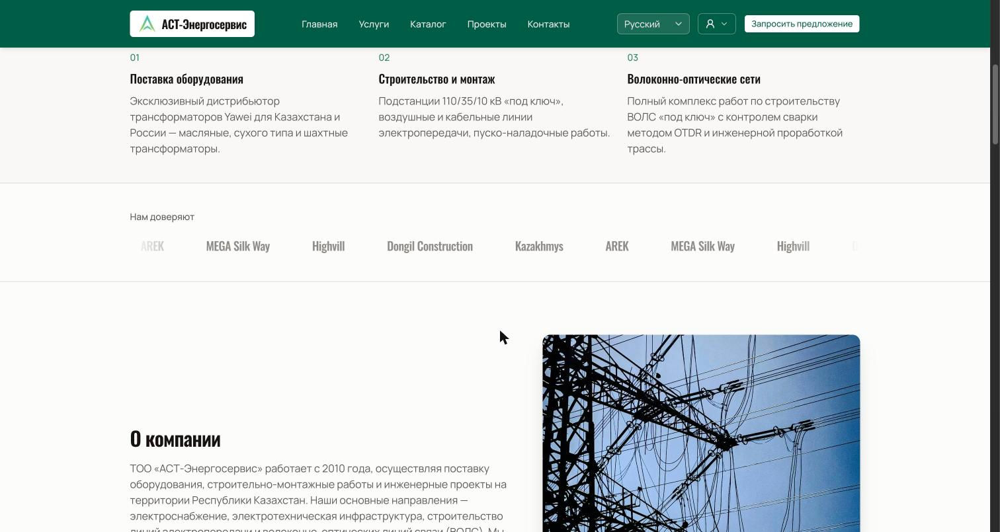

# AST-Energoservice: B2B website (case study)

**Client:** AST-Energoservice, Astana, Kazakhstan: supplier, installer and commissioner of power transformers and substation equipment (official Yawei distributor for Kazakhstan and Russia).
**My role:** design and full-stack build, end to end (freelance, Sularys), built with Claude Code.
**Status:** 🟢 live in production: **https://transformer-site-two.vercel.app/en**

> The source code belongs to the client and stays private. This repository shows the result and the approach.

## The brief
A site that feels like engineering, not e-commerce: technical buyers compare kV ratings and series numbers, the company serves Kazakhstan, the CIS and Central Asia, and every "Request a quote" click should become a structured lead the staff can price without a phone call.

## What I built
- **3 languages:** English, Russian, Kazakh (`/en`, `/ru`, `/kk`)
- **Product catalog:** transformers (oil, dry, mine type, power) and switchgear/substations
- **Quote-request intake:** structured form → lead in the database → email notification
- **Staff admin panel:** sign-in for staff, list of incoming requests
- **Security:** database row-level security, staff-only access

## Tech stack
Next.js · Supabase (auth, Postgres, row-level security) · Vercel · Resend (email) · GSAP (animations)

## Screenshots

**Home (English)**

**Product catalog**

**Home (Russian)**

📄 Full case study: [AST-Energoservice-Case-Study.pdf](AST-Energoservice-Case-Study.pdf)
